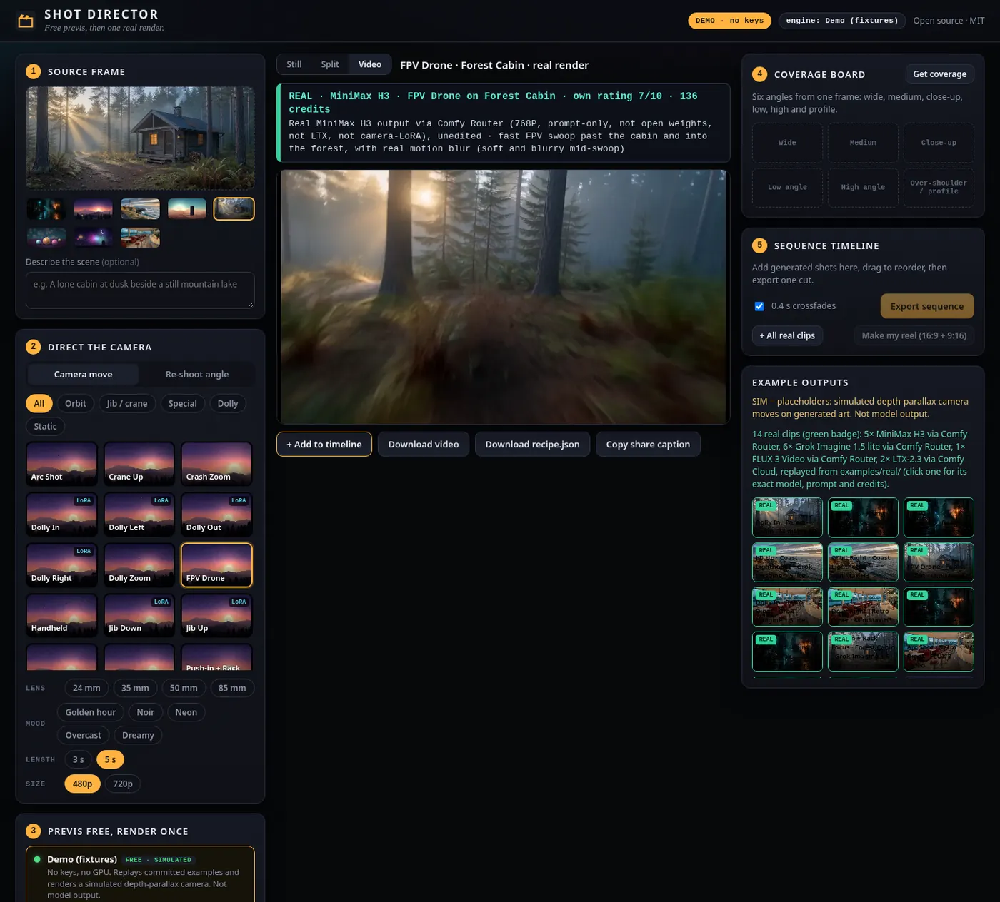
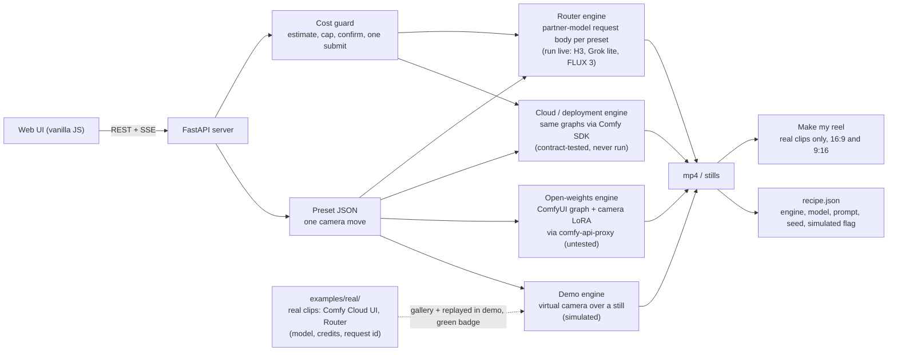

# Shot Director

[](https://github.com/bolttmade/shot-director/actions/workflows/ci.yml)

**Free previs, then one real render.** An open-source camera-move studio for Comfy workflows, built on the [Comfy Developer Platform](https://docs.comfy.org): pick a camera move and preview it for free with a simulated camera, then spend credits once on the real render from the model of your choice. Re-shoot the frame from another angle, get a six-shot coverage board, A/B the result against the still, and cut the real clips into a 16:9 or 9:16 reel. One UI, one preset format, four interchangeable engines (offline demo, open weights on your own GPU, Comfy Cloud, Comfy Router partner models).




> **Honesty box (read this first).**
> * **Real model output in this repo (14 clips, 6 stills), all unedited and shown with a green badge that names the model:** 2 LTX-2.3 clips from Comfy Cloud (prompt-only, no camera LoRA); 12 image-to-video clips made through the **Comfy Router API** from 3 partner models (5 MiniMax H3, 6 Grok Imagine 1.5 lite, 1 FLUX 3 Video; 8 of them on stills that FLUX 3 Image generated, 4 on the alley); and 6 FLUX 3 Image angle re-shoots of the alley. The Router models are **partner models: not open weights, not LTX, not a camera LoRA**. Own quality ratings (4 to 8 out of 10) and the credits each cost are in the clip notes and [docs/REAL_RUN.md](docs/REAL_RUN.md). Details: [Real vs simulated outputs](#real-vs-simulated-outputs).
> * `DEMO=1` runs with **no keys, no GPU, no network**. In that mode everything that is not one of those real files is a **simulated depth-parallax camera move**, the free **previs**: badged amber ("Demo fixture: simulated camera move, not model output") and recorded as `"simulated": true`. It is a preview of the move, not a generated video.
> * **Router: run live.** MiniMax H3, Grok lite, FLUX 3 Image (text-to-image and edits) and FLUX 3 Video all ran against the live API on 2026-10-16 (about 1,310 credits, about $6.21, every request logged with its request id in [docs/COSTS.md](docs/COSTS.md)). `/estimate` is **not enabled** for the workspace used, so the app priced runs with a static table (now set to the measured rates) and the real charge was read from the balance.
> * The **open-weights** path (camera-LoRA graphs written for LTX-2 19B, not LTX-2.3; Qwen angle LoRA) and the Cloud adapter are implemented to the documented SDK contract and covered by contract tests with a fake client, but were **not run against a live server**. The ComfyUI graphs in `workflows/` are **UNTESTED**. No camera-LoRA result exists. See [Status](#status-what-is-verified-and-what-is-not).

## Run it in under five minutes (no keys)

```bash
git clone https://github.com/bolttmade/shot-director.git && cd shot-director
./run.sh                      # creates .venv, installs light deps, starts DEMO mode (Python 3.10+ and ffmpeg required)
# open http://127.0.0.1:8000
```

Or with Docker: `docker build -t shot-director . && docker run --rm -p 8000:8000 shot-director` (demo mode, no keys).

Manual: `python3 -m venv .venv && .venv/bin/pip install -r requirements.txt && DEMO=1 .venv/bin/python -m app.server`.
Needs Python 3.10+ and `ffmpeg` on PATH (for encoding clips and stitching sequences). No torch, no GPU libraries, no bundler, no CDN: the UI is plain HTML/CSS/JS served by the app.

Try this: pick the **Forest Cabin** frame → **FPV Drone** → **Previs this shot (free)** (simulated, amber badge) → **Play the real render** (the real MiniMax H3 clip, green badge, with its credits). Then pick **Rainy Alley** → **Get coverage** (the six real FLUX 3 stills, green board badge) → **+ All real clips** → **Make my reel (16:9 + 9:16)**.

| | |
|---|---|
|  |  |
| A/B player: still vs clip | Coverage board: six real FLUX 3 Image angles of the alley (replayed in demo mode, green badge) |

More: [simulated orbit](docs/screenshots/03-simulated-orbit.webp), [timeline export](docs/screenshots/05-timeline-export.webp), [angle re-shoot](docs/screenshots/06-reshoot-angle.webp), [mobile](docs/screenshots/07-mobile.webp), [error state](docs/screenshots/08-error.webp).

## How it fits together



One preset (for example `dolly-in`) is a small JSON file holding the prompt template, a camera-LoRA recipe, a Router request body and the virtual-camera parameters, so one named move maps to three backends (a free simulated camera for previs, a ComfyUI graph, a partner-model request). Details: [docs/HOW_IT_WORKS.md](docs/HOW_IT_WORKS.md).

## What it does

1. **Camera moves.** 17 presets (dolly in/out/left/right/zoom, jib up/down, crane, orbit, arc, push-in with rack focus, whip pan, FPV, handheld, crash zoom, static). Each is a JSON file that maps to a ComfyUI workflow *and* a Router model ([add your own](docs/ADDING_A_MOVE.md)). Seven name an official LTX-2 camera-control LoRA (never run here; made for LTX-2 19B).
2. **Re-shoot angle.** Drag a virtual camera around the subject (azimuth/elevation/distance). In demo mode this is a simulated reframe. The open-weights path is designed around the Qwen-Image-Edit-2511 *Multiple Angles* LoRA vocabulary (untested); the Router engine uses FLUX 3 Image edits with a natural-language camera prompt (run live for the six-shot coverage; the single-angle re-shoot uses the same code path).
3. **Coverage board.** Wide, medium, close-up, low, high and profile from one still; any tile can become the next source frame ("ANIMATE"). For the alley these are **six real FLUX 3 Image edits** (86.9 credits, replayed free in demo mode, green badge); for other frames demo mode simulates them (amber).
4. **A/B player, timeline and reel.** Compare still and clip, drag shots to reorder, crossfade or hard-cut, export one mp4 (ffmpeg `xfade`). **Make my reel** cuts only the real clips, labelled "REAL: model via platform", in 16:9 and 9:16 (samples in [`examples/reels/`](examples/reels/README.md)). Recipes (`recipe.json`) are written next to every output: engine, model, prompt, seed, workflow hash, credits.

## Engines

| Engine | Needs | Cost | Models | Tested here |
|---|---|---|---|---|
| **Demo** (`demo`) | nothing | free | none: simulated depth-parallax camera | **Yes, end to end** (tests + screenshots) |
| **Open weights** (`open`) | ComfyUI + `comfy-api-proxy` + models ([docs/MODELS.md](docs/MODELS.md)) on a GPU | $0 | LTX-2 19B + camera LoRAs (not LTX-2.3); Qwen-Image-Edit-2511 + Multiple-Angles LoRA | Adapter: contract-tested with a fake client. Graphs: **UNTESTED** |
| **Cloud / deployment** (`cloud`) | `COMFY_API_KEY`, paid plan or a Comfy API deployment | GPU-seconds, **not quotable ahead of time** | same graphs as above | Adapter: contract-tested. **Never run** |
| **Router** (`router`) | `COMFY_API_KEY` + credits | per request, capped and confirmed; priced from a static table because `/estimate` is not enabled for this workspace ([docs/COSTS.md](docs/COSTS.md)) | MiniMax H3 (default), Grok Imagine 1.5 lite, FLUX 3 Video; FLUX 3 Image for stills and coverage; Seedance 2.5 (not run) | Adapter: contract-tested, **and run live** on 2026-10-16: 12 video requests, 9 FLUX image requests, 0 failures. `/estimate` not enabled; Seedance not run |

The engine panel shows which are ready and exactly what each missing one needs. The **open** engine uses only open-weights models and no partner/API nodes (`python scripts/check_open_weights.py` verifies the shipped graphs).

## Run with real models

**Open weights (own GPU, $0).** Install [ComfyUI](https://github.com/comfyanonymous/ComfyUI) and the [LTX-Video nodes](https://github.com/Lightricks/ComfyUI-LTXVideo), download the models listed in [docs/MODELS.md](docs/MODELS.md) (weights are *not* bundled; check each licence), then:

```bash
pip install comfy-api-proxy && comfy-api-proxy        # proxies ComfyUI :8188 -> :8189, no API key
COMFY_BASE_URL=http://127.0.0.1:8189 .venv/bin/python -m app.server    # no DEMO
```

Loopback/private base URLs select the `open` engine; anything else selects `cloud`. VRAM requirements are **unverified** (LTX-2 19B and Qwen-Image-Edit 20B are large; plan on 24 GB+ or quantised variants).

**Router (credits).** `cp .env.example .env`, set `COMFY_API_KEY`, then start without `DEMO`. Every run is priced first (Router's `/estimate` when your workspace has it enabled; otherwise a labelled static price table, which is what ran here), shown in the UI, and refused if it exceeds `MAX_CREDITS_PER_RUN` (default 50 credits, about $0.24). **Heads-up:** the default MiniMax H3 clip (5 s) costs about **136 credits**, which is above the default cap of 50, so it is refused until you raise the cap on purpose: set `MAX_CREDITS_PER_RUN=150` (or higher) in `.env` and restart, or pick a cheaper model such as Grok Imagine 1.5 lite (48 credits for 5 s at 720p; [docs/COSTS.md](docs/COSTS.md)). The UI then asks for a confirmation before each paid run (the request carries `confirm_cost: true` only after you accept; the API refuses paid runs without it). The SDK `submit` is called **once and never retried**, and result URLs (which expire in 12-24 h) are downloaded immediately.

## How it uses the Comfy Developer Platform

* **Comfy SDK** (`comfy-sdk` 0.5.0, `import comfy_sdk`): `Comfy()`, `client.workflows.from_file`, `client.assets.from_file`, `Workflow.set_input` / `remove_node`, `client.submit`, `job.events()`, `job.get_outputs(node).to_file()` (workflow engines); `client.models.submit` → `handle.iter_events()` → `handle.get()` (Router).
* **Comfy Router** (`https://api.comfy.org`): queued requests with per-model native schemas (`POST /v2/models/{provider}/{model}`; `/estimate` is called first but was not enabled for this workspace). Model ids run live: `minimax/minimax-h3`, `xai/grok-imagine-video-1.5-lite`, `bfl/flux-3-image`, `bfl/flux-3-video`. Coded but not run: `byteplus/dreamina-seedance-2-5-260628`, `ltx/ltx-2-5-fast` (text-to-video only, so not used for image-to-video).
* **Comfy API / Cloud / deployments / `comfy-api-proxy`**: one workflow adapter, retargeted with `COMFY_BASE_URL`.

Design details: [docs/HOW_IT_WORKS.md](docs/HOW_IT_WORKS.md). Costs and the credit log: [docs/COSTS.md](docs/COSTS.md). What actually ran: [docs/PROCESS.md](docs/PROCESS.md). Models and licences: [docs/MODELS.md](docs/MODELS.md).

## Real vs simulated outputs

| | Real | Simulated |
|---|---|---|
| What | **14 clips**: 2 LTX-2.3 from Comfy Cloud (`alley__dolly-in`, `alley__crane-up`; web UI, official *LTX-2.3: Image to Video* template); **12 via the Comfy Router API** (`scripts/smoke_real.py`): 5 MiniMax H3, 6 Grok Imagine 1.5 lite, 1 FLUX 3 Video, on 4 stills (`alley`, `forest-cabin`, `retro-diner`, `coast-lighthouse`). **6 stills**: the alley coverage, FLUX 3 Image edits. All **prompt-only, no camera LoRA, unedited**; Router models are partner models, **not open weights, not LTX** | The previs: the app's depth-parallax virtual camera over a still, and every other clip, tile and thumbnail |
| Where | `examples/real/` (clips, notes, recipes, `coverage/`), LTX workflows in `workflows/real/` | `examples/outputs/`, `examples/presets/`, anything you generate in demo mode |
| Badge | green, naming the model and platform | amber "Demo fixture: simulated" |

Best clips (own rating, out of 10): `forest-cabin` FPV drone and dolly-in on MiniMax H3 (8), the alley orbit-left on Grok lite (7; the orbit the free LTX-2.3 prompt-only run could not do). Weakest: FLUX 3 Video arc (4: pretty, barely moves) and the LTX clips (5, 5). Per-clip credits: H3 135.78, Grok lite 48.28, FLUX 3 Video 226.3, FLUX 3 Image 14.48 per still. Everything is in the gallery in the app, best-rated first, and in [docs/REAL_RUN.md](docs/REAL_RUN.md); [docs/PROCESS.md](docs/PROCESS.md) shows the graphs that ran.

No camera-LoRA result exists in this repo, and none is claimed. Limitation: camera control from a prompt alone is unreliable (see the ratings), and the LoRA path needs a local GPU (untested). In demo mode a real clip replaces the simulated one only for the same input and move with an unchanged request, and only for the plain `<input>__<preset>.mp4` clips; Router clips (`__router-...`) are gallery clips plus a "Play the real render" shortcut. After dropping new clips into `examples/real/`, run `make import-real`.

## Status: what is verified and what is not

| Area | Status |
|---|---|
| Demo engine, server, UI, timeline, stitching | Working; `pytest -q` covers it; screenshots in `docs/screenshots/` |
| Presets (17), schema, prompt building | Validated by tests |
| Router adapter | Contract-tested (mocked `/estimate`, fake SDK client): cap, unknown-cost refusal, single submit, 402 handling, URL extraction, FLUX request bodies. **Run live** on 2026-10-16: 12 image-to-video clips (MiniMax H3 x5, Grok lite x6, FLUX 3 Video x1), 3 FLUX 3 text-to-image stills and 6 FLUX 3 image edits (alley coverage); estimates came from the static table because `/estimate` was not enabled; no errors and no retries. Seedance 2.5 and LTX via Router not run. Single-angle re-shoot on the Router uses the same edit path as coverage but was not run on its own |
| Workflow adapter | Contract-tested with a fake client against the real graphs and `.meta.json` node ids. Not run live |
| `workflows/*.json` | **UNTESTED** in ComfyUI. Assembled from the official LTX-2 and Qwen angle examples; node ids checked statically |
| Open-weights compliance | Static check only (no partner/API nodes); weights installed on a server are not verified |
| SDK 0.5.0 surface | Checked against the installed package by `tests/test_sdk_surface.py` |
| Example outputs in `examples/outputs/` | **Simulated** placeholders (see [examples/CREDITS.md](examples/CREDITS.md)) |
| `examples/real/` | 14 real clips and 6 real stills: 2 LTX-2.3 (Comfy Cloud) and 12 Router clips, plus the FLUX 3 coverage (all prompt-only, unedited, mixed quality, rated 4-8/10). Importer, badge and engine preference are tested with synthetic clips, and a test checks that every Router clip's notes say real, partner model, not open weights, unedited, with credits and a request id |
| `workflows/ltx23_i2v_official_template.json` | Unmodified official Comfy Org template (MIT), valid JSON, scanned: no partner/API nodes. Not run by us |

Known gaps: Router `/estimate` answered `not_enabled` for the workspace used here (the app falls back to a static price table and says so); partner pricing drifts (FLUX is usage-based), so budget 10-15% either way; uploaded images get a heuristic pseudo-depth in Demo mode (the alley has a hand-tuned geometric depth map from `scripts/make_alley_depth.py`), so parallax on photos is only a rough approximation; Demo "re-shoot" cannot show the far side of an object, so angles are clamped.

## Smoke test with your own key

`python scripts/smoke_real.py` runs **one** Router request (`--model`, `--input`, `--preset`, `--resolution`, `--max-credits`, `--report` to log the balance before and after): it prints the price first, refuses to run over the cap, asks you to confirm, submits once and never retries. `scripts/router_still.py` makes one FLUX 3 still, `scripts/router_coverage.py` the six-shot coverage board. Nothing runs without `COMFY_API_KEY` and an explicit `--yes`/confirmation. See each script's `--help`.

## Tests

```bash
.venv/bin/pip install -r requirements-dev.txt
.venv/bin/python -m pytest -q
```

CI runs the same tests (no secrets) on Python 3.10 to 3.12: [`.github/workflows/ci.yml`](.github/workflows/ci.yml). Contributing: [CONTRIBUTING.md](CONTRIBUTING.md).

## Layout

```
app/            server.py (FastAPI + SSE), engines/ (base, fixtures, workflow, router), vcam.py (demo camera), stitch.py, presets.py
presets/        camera moves as JSON (+ schema, lens/mood options)
workflows/      ComfyUI API-format graphs + .meta.json node-id maps (UNTESTED, open-weights only)
web/            index.html, app.js, style.css (no build step, no CDN)
examples/       sample frames, simulated clips/stills, recipes, real/ (real clips + coverage), reels/ (sample exports), CREDITS.md
docs/           HOW_IT_WORKS, ADDING_A_MOVE, COSTS (credit log), MODELS, REAL_RUN, PROCESS (graphs that ran), DEMO_*, screenshots
scripts/        make_fixtures.py, build_workflows.py, check_open_weights.py, import_real.py, make_alley_depth.py, smoke_real.py, router_still.py, router_coverage.py, screenshots.py
tests/
```

## License

MIT, see [LICENSE](LICENSE). Model weights are **not** included and keep their own licences ([docs/MODELS.md](docs/MODELS.md)). The four sample frames are procedurally generated by `app/procart.py` (CC0). `examples/inputs/alley.jpg` and the three FLUX 3 stills (`forest-cabin`, `retro-diner`, `coast-lighthouse`) are AI-generated originals (provenance and exact prompts in [examples/CREDITS.md](examples/CREDITS.md)); no photos, people, brands or logos intended. Partner-model outputs keep their providers' terms.

