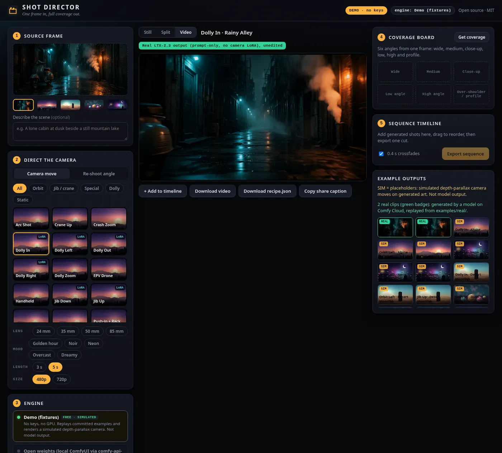
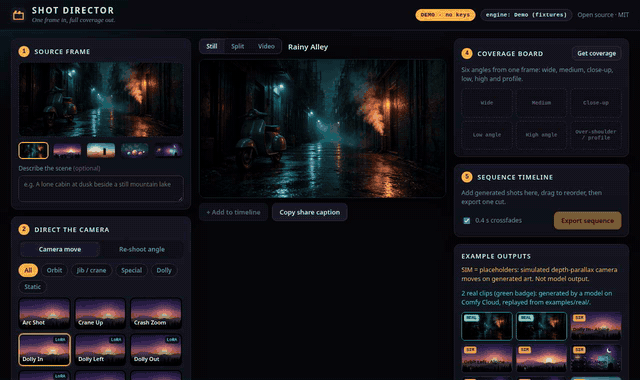
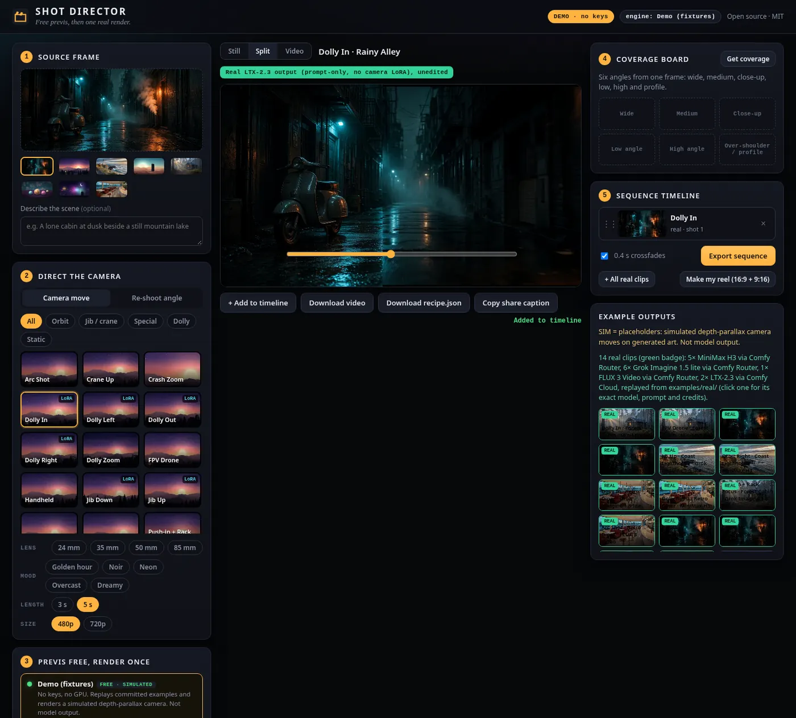
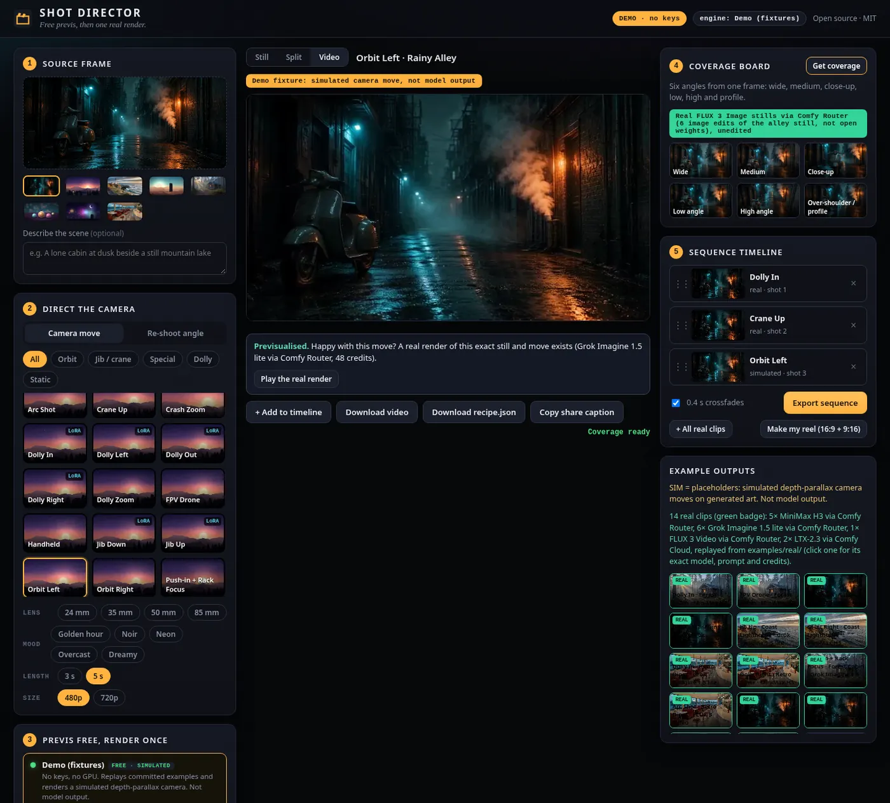
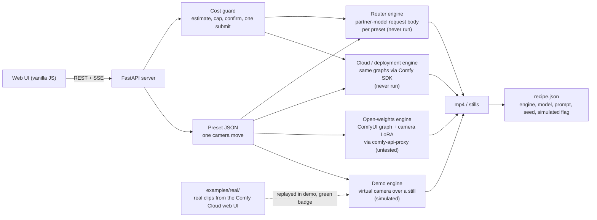

# Shot Director

**One frame in, full coverage out.** An open-source camera-move studio for Comfy workflows, built on the [Comfy Developer Platform](https://docs.comfy.org): pick a camera move, re-shoot the frame from another angle, get a six-shot coverage board, A/B the result against the still, and cut it all into a sequence. One UI, one preset format, four interchangeable engines (offline demo, open weights on your own GPU, Comfy Cloud, Comfy Router partner models).





> **Honesty box (read this first).**
> * **Real model output in this repo:** two LTX-2.3 clips made on Comfy Cloud with a prompt only (no camera LoRA), plus one Grok Imagine 1.5 lite clip made through the Comfy Router API (prompt-only, not open weights), all unedited and shown with a green badge. Nothing else here is real model output. Details: [Real vs simulated outputs](#real-vs-simulated-outputs).
> * `DEMO=1` runs with **no keys, no GPU, no network**. In that mode every other video and still is a **simulated depth-parallax camera move**, badged amber ("Demo fixture: simulated camera move, not model output") and recorded as `"simulated": true`.
> * The **open-weights** (camera-LoRA graphs written for LTX-2 19B, not LTX-2.3; Qwen angle LoRA) path is implemented to the documented SDK contract and covered by contract tests with a fake client, but was **not run against a live server**. The **Router** image-to-video path was run live once (one clip, about 30-33 credits; `/estimate` was not enabled for the workspace, so the static price table was used); the FLUX stills on Router were not. The ComfyUI graphs in `workflows/` are **UNTESTED**. See [Status](#status-what-is-verified-and-what-is-not).

## Run it in under five minutes (no keys)

```bash
git clone https://github.com/bolttmade/shot-director.git && cd shot-director
./run.sh                      # creates .venv, installs light deps, starts DEMO mode (Python 3.10+ and ffmpeg required)
# open http://127.0.0.1:8000
```

Or with Docker: `docker build -t shot-director . && docker run --rm -p 8000:8000 shot-director` (demo mode, no keys).

Manual: `python3 -m venv .venv && .venv/bin/pip install -r requirements.txt && DEMO=1 .venv/bin/python -m app.server`.
Needs Python 3.10+ and `ffmpeg` on PATH (for encoding clips and stitching sequences). No torch, no GPU libraries, no bundler, no CDN: the UI is plain HTML/CSS/JS served by the app.

Try this: the app opens on the alley frame → **Dolly In** → **Generate shot** (replays the real clip, green badge) → **+ Add to timeline** → **Orbit Left** (simulated, amber badge) → add it too → **Export sequence**. Then **Get coverage** and **Re-shoot angle** (drag the dial).

| | |
|---|---|
|  |  |
| A/B player: still vs clip | Coverage board: six angles from one frame (simulated in demo mode) |

More: [simulated orbit](docs/screenshots/03-simulated-orbit.webp), [timeline export](docs/screenshots/05-timeline-export.webp), [angle re-shoot](docs/screenshots/06-reshoot-angle.webp), [mobile](docs/screenshots/07-mobile.webp), [error state](docs/screenshots/08-error.webp).

## How it fits together



One preset (for example `dolly-in`) is a small JSON file holding the prompt template, a camera-LoRA recipe, a Router request body and the virtual-camera parameters, so one named move maps to three backends. Details: [docs/HOW_IT_WORKS.md](docs/HOW_IT_WORKS.md).

## What it does

1. **Camera moves.** 17 presets (dolly in/out/left/right/zoom, jib up/down, crane, orbit, arc, push-in with rack focus, whip pan, FPV, handheld, crash zoom, static). Each is a JSON file that maps to a ComfyUI workflow *and* a Router model ([add your own](docs/ADDING_A_MOVE.md)). Seven name an official LTX-2 camera-control LoRA (never run here; made for LTX-2 19B).
2. **Re-shoot angle.** Drag a virtual camera around the subject (azimuth/elevation/distance). In demo mode this is a simulated reframe. The open-weights path is designed around the Qwen-Image-Edit-2511 *Multiple Angles* LoRA vocabulary (untested); Router uses FLUX 3 image editing (never run).
3. **Coverage board.** Wide, medium, close-up, low, high and profile from one still; any tile can become the next source frame ("ANIMATE"). Simulated in demo mode.
4. **A/B player and sequence timeline.** Compare still and clip, drag shots to reorder, crossfade or hard-cut, export one mp4 (ffmpeg `xfade`). Recipes (`recipe.json`) are written next to every output: engine, model, prompt, seed, workflow hash, credits.

## Engines

| Engine | Needs | Cost | Models | Tested here |
|---|---|---|---|---|
| **Demo** (`demo`) | nothing | free | none: simulated depth-parallax camera | **Yes, end to end** (tests + screenshots) |
| **Open weights** (`open`) | ComfyUI + `comfy-api-proxy` + models ([docs/MODELS.md](docs/MODELS.md)) on a GPU | $0 | LTX-2 19B + camera LoRAs (not LTX-2.3); Qwen-Image-Edit-2511 + Multiple-Angles LoRA | Adapter: contract-tested with a fake client. Graphs: **UNTESTED** |
| **Cloud / deployment** (`cloud`) | `COMFY_API_KEY`, paid plan or a Comfy API deployment | GPU-seconds, **not quotable ahead of time** | same graphs as above | Adapter: contract-tested. **Never run** |
| **Router** (`router`) | `COMFY_API_KEY` + credits | per request, estimated first ([docs/COSTS.md](docs/COSTS.md)) | MiniMax H3 (default), Seedance 2.5, Grok Imagine 1.5 lite; FLUX 3 for stills | Adapter: contract-tested against recorded schemas. **Never run** |

The engine panel shows which are ready and exactly what each missing one needs. The **open** engine uses only open-weights models and no partner/API nodes (`python scripts/check_open_weights.py` verifies the shipped graphs).

## Run with real models

**Open weights (own GPU, $0).** Install [ComfyUI](https://github.com/comfyanonymous/ComfyUI) and the [LTX-Video nodes](https://github.com/Lightricks/ComfyUI-LTXVideo), download the models listed in [docs/MODELS.md](docs/MODELS.md) (weights are *not* bundled; check each licence), then:

```bash
pip install comfy-api-proxy && comfy-api-proxy        # proxies ComfyUI :8188 -> :8189, no API key
COMFY_BASE_URL=http://127.0.0.1:8189 .venv/bin/python -m app.server    # no DEMO
```

Loopback/private base URLs select the `open` engine; anything else selects `cloud`. VRAM requirements are **unverified** (LTX-2 19B and Qwen-Image-Edit 20B are large; plan on 24 GB+ or quantised variants).

**Router (credits).** `cp .env.example .env`, set `COMFY_API_KEY`, then start without `DEMO`. Every run is estimated first through Router's `/estimate`, shown in the UI, and refused if it exceeds `MAX_CREDITS_PER_RUN` (default 50 credits, about $0.24). **Heads-up:** the default MiniMax H3 clip (5 s) costs about **136 credits**, which is above the default cap of 50, so it is refused until you raise the cap on purpose: set `MAX_CREDITS_PER_RUN=150` (or higher) in `.env` and restart, or pick a cheaper model such as Grok Imagine 1.5 lite ([docs/COSTS.md](docs/COSTS.md)). The UI then asks for a confirmation before each paid run (the request carries `confirm_cost: true` only after you accept; the API refuses paid runs without it). The SDK `submit` is called **once and never retried**, and result URLs (which expire in 12-24 h) are downloaded immediately.

## How it uses the Comfy Developer Platform

* **Comfy SDK** (`comfy-sdk` 0.5.0, `import comfy_sdk`): `Comfy()`, `client.workflows.from_file`, `client.assets.from_file`, `Workflow.set_input` / `remove_node`, `client.submit`, `job.events()`, `job.get_outputs(node).to_file()` (workflow engines); `client.models.submit` → `handle.iter_events()` → `handle.get()` (Router).
* **Comfy Router** (`https://api.comfy.org`): `POST /v2/models/{provider}/{model}/estimate`, queued requests, per-model native schemas. Model ids used: `minimax/minimax-h3`, `byteplus/dreamina-seedance-2-5-260628`, `xai/grok-imagine-video-1.5-lite`, `ltx/ltx-2-5-fast` (text-to-video only, so not used for image-to-video), `bfl/flux-3-image`.
* **Comfy API / Cloud / deployments / `comfy-api-proxy`**: one workflow adapter, retargeted with `COMFY_BASE_URL`.

Design details: [docs/HOW_IT_WORKS.md](docs/HOW_IT_WORKS.md). Costs: [docs/COSTS.md](docs/COSTS.md). Models and licences: [docs/MODELS.md](docs/MODELS.md).

## Real vs simulated outputs

| | Real | Simulated |
|---|---|---|
| What | 3 clips: `alley__dolly-in` and `alley__crane-up` from LTX-2.3 on Comfy Cloud (web UI, official *LTX-2.3: Image to Video* template), and `alley__dolly-in__router-grok-imagine-1-5-lite` from Grok Imagine 1.5 lite via the Comfy Router API (`scripts/smoke_real.py`; a partner model, **not open weights**). All **prompt-only, no camera LoRA, unedited** | Everything else: the app's depth-parallax virtual camera over a still |
| Where | `examples/real/`, workflows in `workflows/real/` | `examples/outputs/`, `examples/presets/`, anything you generate in demo mode |
| Badge | green | amber "Demo fixture: simulated" |

No camera-LoRA result exists in this repo, and none is claimed. Limitation: camera control from a prompt alone is unreliable, and the LoRA path needs a local GPU (untested). Prompts, settings, verdicts and the failed attempts are in [docs/REAL_RUN.md](docs/REAL_RUN.md). In demo mode a real clip replaces the simulated one only for the same input and move with an unchanged request. After dropping new clips into `examples/real/`, run `make import-real`.

## Status: what is verified and what is not

| Area | Status |
|---|---|
| Demo engine, server, UI, timeline, stitching | Working; `pytest -q` covers it; screenshots in `docs/screenshots/` |
| Presets (17), schema, prompt building | Validated by tests |
| Router adapter | Contract-tested (mocked `/estimate`, fake SDK client): cap, unknown-cost refusal, single submit, 402 handling, URL extraction. **Run live once** for image-to-video (Grok Imagine 1.5 lite, 5 s @ 480p, estimate by static table because `/estimate` was not enabled, about 30-33 credits, no errors). FLUX stills and other models not run live |
| Workflow adapter | Contract-tested with a fake client against the real graphs and `.meta.json` node ids. Not run live |
| `workflows/*.json` | **UNTESTED** in ComfyUI. Assembled from the official LTX-2 and Qwen angle examples; node ids checked statically |
| Open-weights compliance | Static check only (no partner/API nodes); weights installed on a server are not verified |
| SDK 0.5.0 surface | Checked against the installed package by `tests/test_sdk_surface.py` |
| Example outputs in `examples/outputs/` | **Simulated** placeholders (see [examples/CREDITS.md](examples/CREDITS.md)) |
| `examples/real/` | 2 real LTX-2.3 clips from Comfy Cloud and 1 real Grok Imagine 1.5 lite clip from the Router (all prompt-only, unedited, mixed quality). Importer, badge and engine preference are tested with synthetic clips; the real files are probed on import |
| `workflows/ltx23_i2v_official_template.json` | Unmodified official Comfy Org template (MIT), valid JSON, scanned: no partner/API nodes. Not run by us |

Known gaps: Router `/estimate` may answer `403 not_enabled` for some workspaces (the app falls back to a static price table and says so); uploaded images get a heuristic pseudo-depth in Demo mode (the alley has a hand-tuned geometric depth map from `scripts/make_alley_depth.py`), so parallax on photos is only a rough approximation; Demo "re-shoot" cannot show the far side of an object, so angles are clamped.

## Smoke test with your own key

`python scripts/smoke_real.py` runs **one tiny** Router request: it prints the estimate first, refuses to run over the cap, asks you to confirm, submits once and never retries. Nothing runs without `COMFY_API_KEY` and an explicit `--yes`/confirmation. See the script's `--help`.

## Tests

```bash
.venv/bin/pip install -r requirements-dev.txt
.venv/bin/python -m pytest -q
```

CI runs the same tests (no secrets) on Python 3.10 to 3.12: [`.github/workflows/ci.yml`](.github/workflows/ci.yml). Contributing: [CONTRIBUTING.md](CONTRIBUTING.md).

## Layout

```
app/            server.py (FastAPI + SSE), engines/ (base, fixtures, workflow, router), vcam.py (demo camera), stitch.py, presets.py
presets/        camera moves as JSON (+ schema, lens/mood options)
workflows/      ComfyUI API-format graphs + .meta.json node-id maps (UNTESTED, open-weights only)
web/            index.html, app.js, style.css (no build step, no CDN)
examples/       sample frames, simulated clips/stills, recipes, CREDITS.md
docs/           HOW_IT_WORKS, ADDING_A_MOVE, COSTS, MODELS, screenshots
scripts/        make_fixtures.py, build_workflows.py, check_open_weights.py, import_real.py, make_alley_depth.py, smoke_real.py, screenshots.py
tests/
```

## License

MIT, see [LICENSE](LICENSE). Model weights are **not** included and keep their own licences ([docs/MODELS.md](docs/MODELS.md)). The four sample frames are procedurally generated by `app/procart.py` (CC0). `examples/inputs/alley.jpg` is an AI-generated original (provenance and exact prompt in [examples/CREDITS.md](examples/CREDITS.md)); no photos, people, brands or logos.

