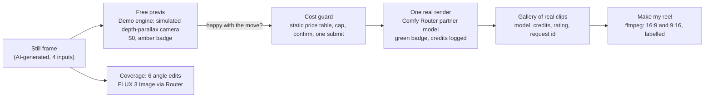
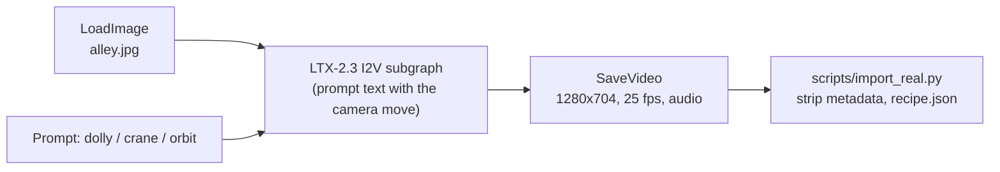
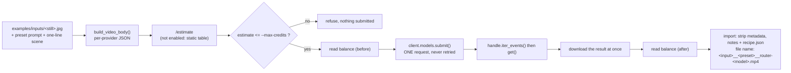
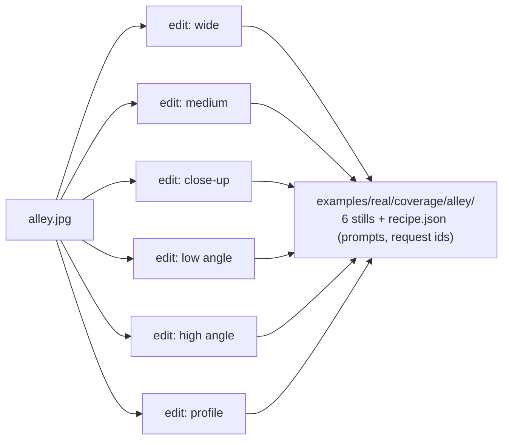

# Process log: the graphs and workflows that actually ran

This is the honest build log for the contest entry: what was run, in which order, on which platform, and what it cost. Everything under "ran" happened on **2026-10-16**. Anything that did not run is listed at the end. Per-clip verdicts: [REAL_RUN.md](REAL_RUN.md). Every credit, with estimate vs measured balance and request ids: [COSTS.md](COSTS.md).

## 1. Overall pipeline (what the product does)

## 2. Graphs and requests that ran

### 2a. LTX-2.3 image-to-video on Comfy Cloud (free tier, web UI, by hand)

Official template *LTX-2.3: Image to Video* (open weights, core nodes only), input `alley.jpg`, prompt-only (no camera LoRA), 5 s, 1280x720. Three runs plus one discarded pilot, $0. The exported graphs are in [`workflows/real/`](../workflows/real/README.md).

Results: dolly-in 5/10 (smooth, some warping), crane-up 5/10 (partial), orbit-left 4/10 (did not orbit; not shown).

### 2b. Comfy Router requests (API, credits)

The app's Router engine builds one native request per provider and runs the same sequence for every model. `scripts/smoke_real.py` is that path for video; `scripts/router_still.py` and `scripts/router_coverage.py` are the FLUX 3 Image paths.

Requests that ran, in time order (UTC dates all 2026-10-16; credits are balance deltas):

| # | Request | Model | Credits |
|---|---|---|---|
| 1 | `alley` + dolly-in, 5 s 480p | `xai/grok-imagine-video-1.5-lite` | about 33 (balance before not read) |
| 2 | `alley` + crane-up, 5 s 720p | Grok lite | 48.27 |
| 3-5 | three text-to-image stills: forest cabin, retro diner, coast lighthouse | `bfl/flux-3-image` | 3 x 14.48 |
| 6-8 | `forest-cabin` dolly-in, `coast-lighthouse` orbit-right, `retro-diner` dolly-right | `minimax/minimax-h3` 768P | 3 x 135.78 |
| 9-12 | `retro-diner` dolly-in, `forest-cabin` push-in-rack, `alley` orbit-left, `coast-lighthouse` jib-up | Grok lite 720p | 4 x 48.28 |
| 13 | `alley` + crane-up | MiniMax H3 | 135.78 |
| 14-19 | alley coverage: wide, medium, close, low, high, profile (six image edits) | `bfl/flux-3-image` | 86.9 total |
| 20 | `forest-cabin` + fpv-drone | MiniMax H3 | 135.78 |
| 21 | `retro-diner` + arc | `bfl/flux-3-video` hd | 226.3 |

Total about **1,310 credits (about $6.21)**; balance afterwards 371.94 cents (about 785 credits, after the 15-credit browser test of the static page). One request per attempt; no retries; no 402; no failed Router call.

### 2c. Coverage graph (FLUX 3 Image edits)

Each edit is a separate request with a natural-language camera prompt (`app/angles.py`). The first live run confirmed the request shape (raw base64, no `data:` prefix) and all six edits succeeded on the first attempt.

### 2d. Make my reel (no credits)

`POST /api/reel` takes the real clips from the timeline, scales and pads each to 16:9 (letterbox) or 9:16 (blurred pad), draws a "REAL: <model> via Comfy Router" label, and joins them with `xfade` crossfades in one ffmpeg run. Samples: [`examples/reels/`](../examples/reels/README.md).

### 2e. Static Space build (no credits)

`scripts/build_static.py` packs `static_site/` (plain HTML/JS, a WebGL depth-parallax shader for the free previs), `data.json` (real-clip notes, credits, request ids), 14 web-copy clips (720p max, H.264, no audio), the four stills with small depth maps and the six real coverage stills into `space/` (about 15 MB) with a Space README header (`sdk: static`, `license: mit`). Published to https://huggingface.co/spaces/BoltTmade/shot-director. Its optional own-key panel was tested once in headless Chrome (15.09 credits, request `d8674baa-a97f-4931-966b-eb6a43d22670`).

## 3. What did not run (so it is not claimed)

* The open-weights graphs (`workflows/ltx2_i2v_camera.json`, `qwen_edit_angle.json`): contract-tested with a fake client only, **UNTESTED in ComfyUI**. No camera-LoRA result exists in this repo.
* The Cloud/deployment adapter: contract-tested, never run live.
* Router `/estimate`: answered "not enabled" for this workspace on every run; every estimate shown came from the static table.
* Seedance 2.5 and LTX via Router: not run. FLUX 3 Video was run once (4/10); no second take was paid for.
* No Router run produced a camera-LoRA clip and none of the Router models are open weights.

## 4. Problems met and how they were handled

| Problem | What happened | Fix |
|---|---|---|
| BFL image field | FLUX wants raw base64 or a URL, not a `data:` URL | `raw_base64()`; checked on the first submitted request |
| Price table drift | Grok 720p billed 48.28 vs 45.26 estimated (+7%); FLUX 3 Video billed 226.3 vs 256.4 estimated (-12%) | table now carries measured rates; documented in COSTS.md |
| Stale balance | after one H3 run the balance read was unchanged; a few minutes later it dropped by exactly 135.78 | re-read the balance; documented |
| Importer resolution | H3 files (1344x768) were rescaled to 1280 wide but the notes still said 1344 | importer records both and `--force` re-imports |
| Badge bug | the coverage result relabelled the clip on the stage | coverage now has its own badge (`#covBadge`) |
