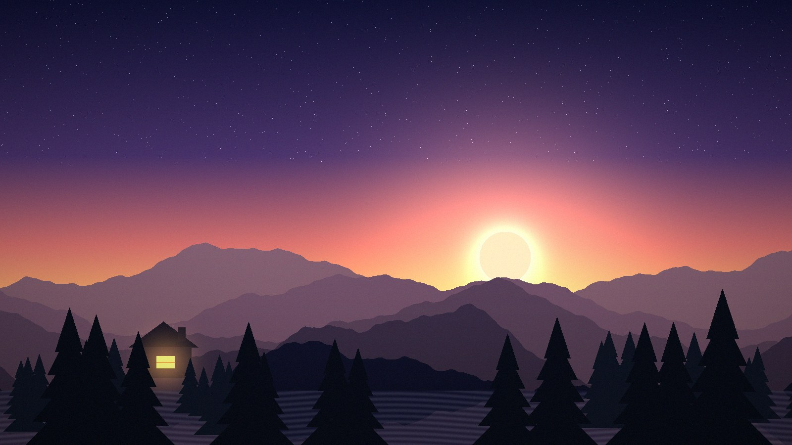
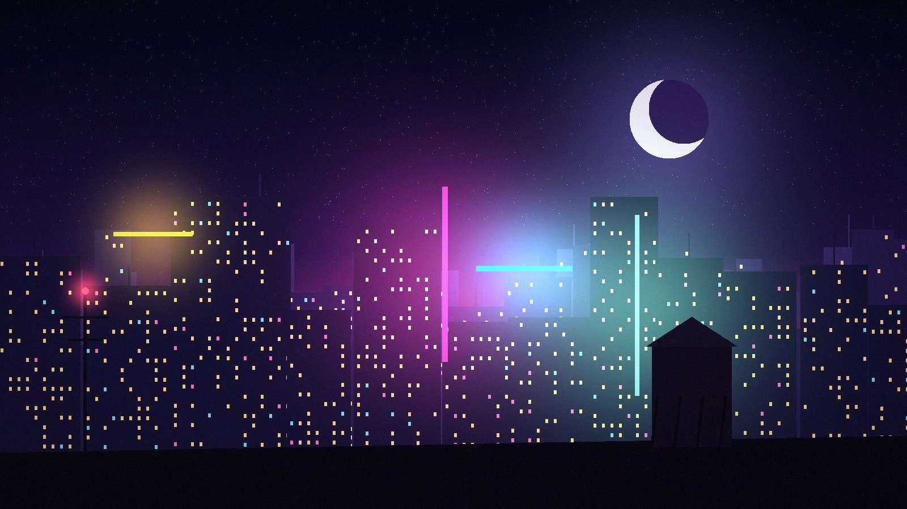
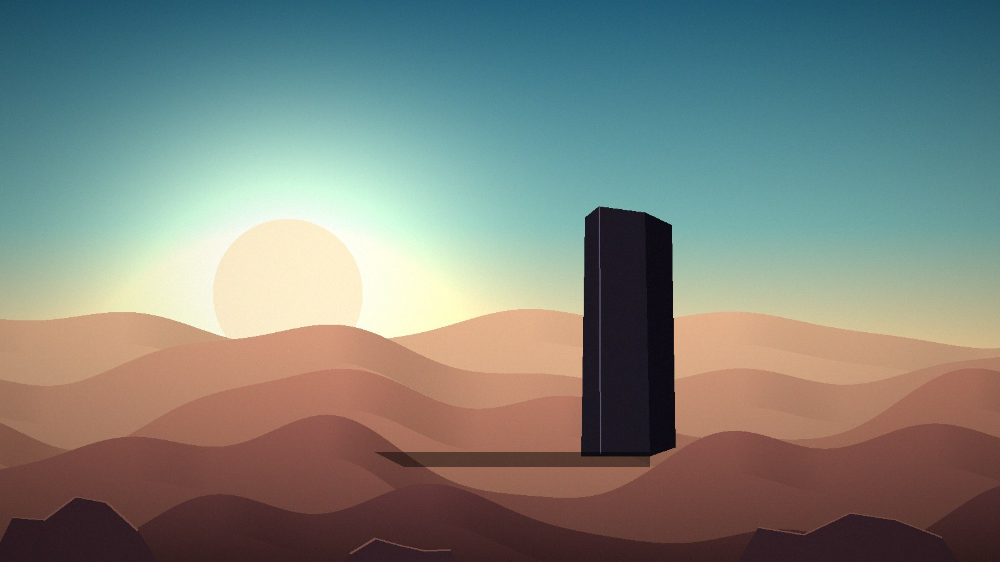
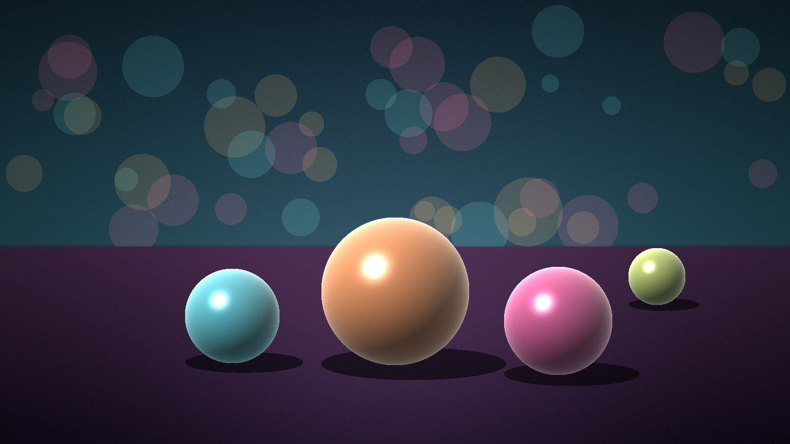

# Example gallery

> **Every output below is a simulated placeholder.** Clips are depth-parallax re-projections of procedurally generated images (`app/vcam.py`), *not* output of LTX-2, Qwen, or any partner model. They exist so the app is fully demonstrable with zero keys, credits or GPU. They will be replaced by real model outputs (each with its own `recipe.json`) when credits/GPU exist. See [`CREDITS.md`](CREDITS.md).

## Alpine Dusk

*Ridges, a lit cabin and a low sun: layered parallax.*

- **dolly-in**: [`outputs/clips/alpine-dusk__dolly-in.mp4`](outputs/clips/alpine-dusk__dolly-in.mp4) · [recipe](outputs/recipes/alpine-dusk__dolly-in.json)
- **orbit-left**: [`outputs/clips/alpine-dusk__orbit-left.mp4`](outputs/clips/alpine-dusk__orbit-left.mp4) · [recipe](outputs/recipes/alpine-dusk__orbit-left.json)
- **jib-up**: [`outputs/clips/alpine-dusk__jib-up.mp4`](outputs/clips/alpine-dusk__jib-up.mp4) · [recipe](outputs/recipes/alpine-dusk__jib-up.json)

Coverage board: [Wide](outputs/coverage/alpine-dusk/wide.jpg) · [Medium](outputs/coverage/alpine-dusk/medium.jpg) · [Close-up](outputs/coverage/alpine-dusk/close.jpg) · [Low angle](outputs/coverage/alpine-dusk/low.jpg) · [High angle](outputs/coverage/alpine-dusk/high.jpg) · [Over-shoulder / profile](outputs/coverage/alpine-dusk/profile.jpg)

## Neon Rooftops

*Night skyline with glowing windows and abstract neon bars.*

- **dolly-in**: [`outputs/clips/neon-rooftops__dolly-in.mp4`](outputs/clips/neon-rooftops__dolly-in.mp4) · [recipe](outputs/recipes/neon-rooftops__dolly-in.json)
- **orbit-left**: [`outputs/clips/neon-rooftops__orbit-left.mp4`](outputs/clips/neon-rooftops__orbit-left.mp4) · [recipe](outputs/recipes/neon-rooftops__orbit-left.json)
- **jib-up**: [`outputs/clips/neon-rooftops__jib-up.mp4`](outputs/clips/neon-rooftops__jib-up.mp4) · [recipe](outputs/recipes/neon-rooftops__jib-up.json)

Coverage board: [Wide](outputs/coverage/neon-rooftops/wide.jpg) · [Medium](outputs/coverage/neon-rooftops/medium.jpg) · [Close-up](outputs/coverage/neon-rooftops/close.jpg) · [Low angle](outputs/coverage/neon-rooftops/low.jpg) · [High angle](outputs/coverage/neon-rooftops/high.jpg) · [Over-shoulder / profile](outputs/coverage/neon-rooftops/profile.jpg)

## Desert Monolith

*A lone standing slab among dunes: strong silhouette for orbit and dolly moves.*

- **dolly-in**: [`outputs/clips/desert-monolith__dolly-in.mp4`](outputs/clips/desert-monolith__dolly-in.mp4) · [recipe](outputs/recipes/desert-monolith__dolly-in.json)
- **orbit-left**: [`outputs/clips/desert-monolith__orbit-left.mp4`](outputs/clips/desert-monolith__orbit-left.mp4) · [recipe](outputs/recipes/desert-monolith__orbit-left.json)
- **jib-up**: [`outputs/clips/desert-monolith__jib-up.mp4`](outputs/clips/desert-monolith__jib-up.mp4) · [recipe](outputs/recipes/desert-monolith__jib-up.json)

Coverage board: [Wide](outputs/coverage/desert-monolith/wide.jpg) · [Medium](outputs/coverage/desert-monolith/medium.jpg) · [Close-up](outputs/coverage/desert-monolith/close.jpg) · [Low angle](outputs/coverage/desert-monolith/low.jpg) · [High angle](outputs/coverage/desert-monolith/high.jpg) · [Over-shoulder / profile](outputs/coverage/desert-monolith/profile.jpg)

## Glass Orbs

*Glossy spheres on a table: clean 3D-ish forms for orbit and coverage.*

- **dolly-in**: [`outputs/clips/glass-orbs__dolly-in.mp4`](outputs/clips/glass-orbs__dolly-in.mp4) · [recipe](outputs/recipes/glass-orbs__dolly-in.json)
- **orbit-left**: [`outputs/clips/glass-orbs__orbit-left.mp4`](outputs/clips/glass-orbs__orbit-left.mp4) · [recipe](outputs/recipes/glass-orbs__orbit-left.json)
- **jib-up**: [`outputs/clips/glass-orbs__jib-up.mp4`](outputs/clips/glass-orbs__jib-up.mp4) · [recipe](outputs/recipes/glass-orbs__jib-up.json)

Coverage board: [Wide](outputs/coverage/glass-orbs/wide.jpg) · [Medium](outputs/coverage/glass-orbs/medium.jpg) · [Close-up](outputs/coverage/glass-orbs/close.jpg) · [Low angle](outputs/coverage/glass-orbs/low.jpg) · [High angle](outputs/coverage/glass-orbs/high.jpg) · [Over-shoulder / profile](outputs/coverage/glass-orbs/profile.jpg)

## Stitched sequence

[`outputs/sequence/demo-sequence.mp4`](outputs/sequence/demo-sequence.mp4): four simulated clips joined with 0.4 s crossfades by `app/stitch.py`.

